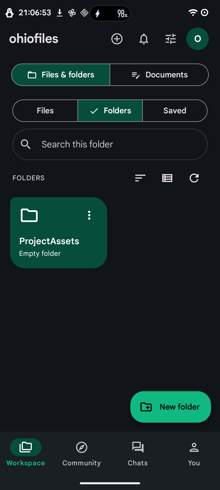
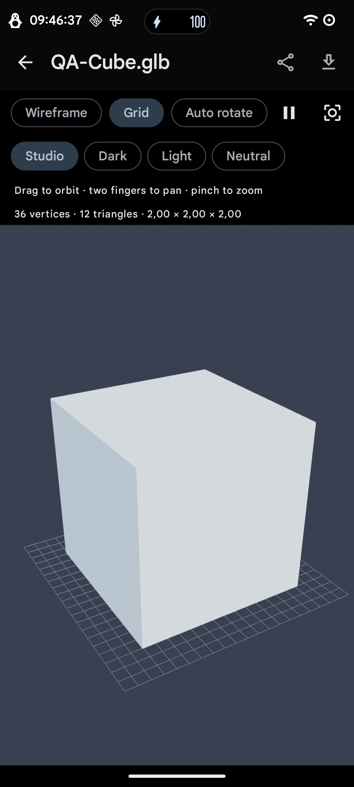
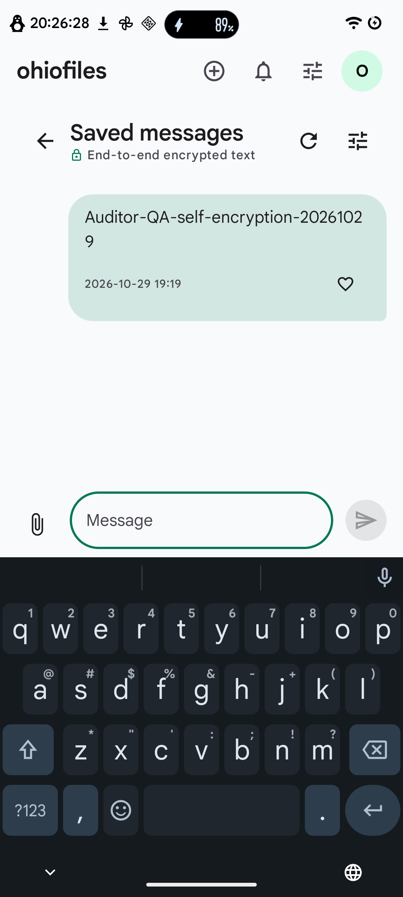
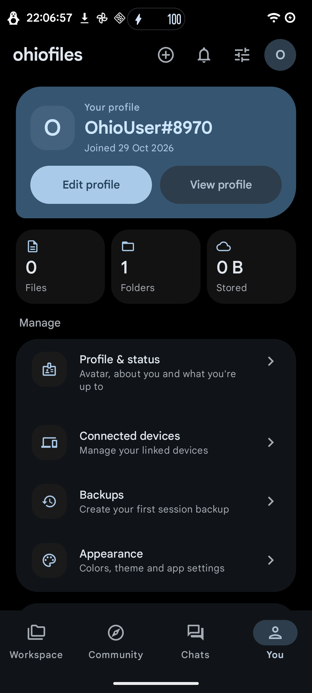

# OhioFiles for Android

<p align="center">
  <strong>Native, secure, and modern Android client for OhioFiles.</strong><br>
  Built with Jetpack Compose, Material 3 Expressive, end-to-end encrypted messaging, offline-first workspace, and 100% native preview engines.
</p>

<p align="center">
  
  
  
  
  
  
  
</p>

---

## 📱 Visual Showcase

| Files & Folders (Dark) | 3D Model Viewer (Filament) | Encrypted Chats (E2EE) | Account & Preferences (AMOLED) |
|:---:|:---:|:---:|:---:|
|  |  |  |  |

---

## ✨ Features

### 📁 Cloud Files & Folders
- **Hierarchical Navigation:** Seamless directory browsing with breadcrumbs, deep nesting, sorting, and type filters.
- **Access Controls & Sharing:** Password-protected folders, public links, expiration settings, and instant QR code generation.
- **Bulk Operations & Undo:** Select, move, download as ZIP, or delete files with scoped undo safety.
- **System Integration:** Scoped document access (Storage Access Framework), system Sharesheet support, and integration with Android `DownloadManager`.

### ⚡ Resilient Upload Pipeline
- **Foreground Transfer Engine:** Powered by AndroidX `WorkManager` with a `dataSync` foreground service that survives app restarts, process termination, and transient network loss.
- **Multipart Streaming Contract:** Respects server-side metadata-before-file streaming contracts to minimize memory footprint.
- **Smart Slugs & Collisions:** Automatically generates persistent 6-character alphanumeric URLs; handles interrupted transfers and confirms collision avoidance.
- **Checksum Validation & Checkpointing:** Verifies byte hashes prior to and after transfers; checkpointing prevents duplicate transfers on retry.

### 📝 Document Studio & Workspace
- **Distraction-Free Editor:** Full-screen Markdown, plain-text, and code editing with a compact document switcher.
- **Live GFM Rendering:** Rich preview engine supporting CommonMark GitHub Flavored Markdown (tables, task lists, strikethrough).
- **Offline Drafts & Conflict Protection:** Persistent local draft cache scoped to session and server. Checksum verification prevents accidental overwrite collisions.

### 🔒 End-to-End Encrypted Chats
- **Zero Plaintext Fallback:** Strict cryptographic guarantee across direct and group conversations.
- **Web-Interoperable Cryptography:** Implements ECDH key exchange, HKDF key derivation, and AES-GCM payload encryption matching the web protocol.
- **Decentralized Push:** Real-time message alerts via UnifiedPush alongside embedded FCM distribution for background delivery.

### 🔭 Native Preview Engines (Zero WebViews)
- **3D Graphics:** Google Filament PBR engine for real-time GLTF/GLB inspection with wireframe, lighting, and material controls.
- **PDF Documents:** Paged PDF rendering with text search and pinch-to-zoom using PDFBox Android.
- **Media Playback:** Native streaming playback for video and audio.
- **Image & Vector:** Hardware-accelerated image decoding with animated GIF and SVG support via Coil.

### 🎨 Material 3 Expressive & System Polish
- **Dynamic Theming:** Monet dynamic wallpaper color, curated palettes, and dedicated pure AMOLED True Black mode.
- **Modern Navigation:** Built with AndroidX Navigation 3, predictive back animations, and nuanced haptic feedback.
- **Edge-to-Edge:** Complete system bar immersion conforming to Android 15 & 16 guidelines.

---

## 🏗️ Architecture & Tech Stack

OhioFiles Android follows official Android Architecture Guidelines with a strictly unidirectional data flow (UDF) and reactive Kotlin Coroutines/Flow state modeling.

```
app/src/main/kotlin/cloud/ohiofiles/app/
├── data/                    # Data Layer
│   ├── api/                 # OkHttp client & REST endpoints
│   ├── crypto/              # ECDH, HKDF, AES-GCM cryptographic engine
│   ├── document/            # Draft persistence & collision management
│   ├── model/               # Kotlinx Serialization domain models
│   ├── repository/          # Repositories mediating network & local cache
│   └── upload/              # Chunked streaming upload queue & journal
├── platform/                # Platform Services
│   ├── push/                # UnifiedPush & FCM handlers
│   └── worker/              # WorkManager dataSync foreground services
└── ui/                      # Presentation Layer (Jetpack Compose)
    ├── components/          # Reusable design components & bottom sheets
    ├── diagram/             # Native Mermaid diagram parser & renderer
    ├── document/            # Full-screen editor & Markdown preview
    ├── preview/             # Google Filament 3D & PDFBox viewers
    ├── screens/             # Workspace, Folders, Community, Chats, You
    └── theme/               # Material 3 Expressive, typography & color schemes
```

### Core Technologies

| Layer | Technologies |
|---|---|
| **Language & Runtime** | Kotlin 2.x, Java 17 toolchain, desugared standard library APIs |
| **UI Framework** | Jetpack Compose, Material 3 Expressive (`material3`), Navigation 3 (`navigation3`) |
| **Async & State** | Kotlinx Coroutines, `StateFlow`, `SharedFlow`, AndroidX Lifecycle ViewModel |
| **Networking & Serialization** | OkHttp 4, Kotlinx Serialization JSON |
| **Background Processing** | AndroidX WorkManager 2.10 (`dataSync` foreground service) |
| **Push Notifications** | UnifiedPush 3.3 connector, Embedded FCM Distributor |
| **3D Rendering** | Google Filament 1.64 (`filament-android`, `gltfio-android`) |
| **Document & Markdown** | Apache PDFBox Android, CommonMark GFM (tables, strikethrough) |
| **Image Loading** | Coil 2.7 (SVG & GIF decoders) |
| **Storage & Security** | Jetpack DataStore Preferences, Android Keystore, Scoped Storage (SAF) |

---

## 🚀 Getting Started

### Prerequisites

- **JDK:** Java 17 or Java 21 (configured for Gradle)
- **Android SDK:** Platform 36 (Android 16), Build Tools 36.x
- **Android Studio:** Ladybug (2024.2.1+) or Meerkat recommended
- **Gradle:** Wrapper included (Gradle 9.1)

### Building from Source

This project isolates build outputs into `artifacts/` rather than default `build/` directories to prevent transient file pollution.

1. **Clone the repository:**
   ```sh
   git clone https://github.com/your-org/OhioFiles-Android.git
   cd OhioFiles-Android
   ```

2. **Configure local environment:**
   Create a `local.properties` file in the root directory specifying your Android SDK path:
   ```properties
   sdk.dir=/path/to/your/android/sdk
   ```

3. **Assemble the debug build:**
   ```sh
   ./gradlew --project-cache-dir artifacts/gradle-cache :app:assembleDebug
   ```
   *Generated output:* `artifacts/app/outputs/apk/debug/app-debug.apk`

4. **Assemble an optimized release build (with R8 shrinking):**
   ```sh
   ./gradlew --project-cache-dir artifacts/gradle-cache :app:assembleRelease
   ```
   *Generated output:* `artifacts/app/outputs/apk/release/app-release.apk`

5. **Install on connected device or emulator:**
   ```sh
   adb install -r artifacts/app/outputs/apk/debug/app-debug.apk
   # Or using the Android CLI tool:
   android run --apks=artifacts/app/outputs/apk/debug/app-debug.apk
   ```

---

## 🧪 Testing & Quality Assurance

OhioFiles Android incorporates comprehensive contract validation, protocol fidelity checks, and on-device instrumentation tests.

- **Unit & Contract Tests:**
  ```sh
  ./gradlew --project-cache-dir artifacts/gradle-cache :app:testDebugUnitTest
  ```
  Validates large multipart stream ordering, query parameter escaping, bookmark authentication, JSON edge cases, and cryptographic vectors against the web platform.

- **Static Analysis & Linting:**
  ```sh
  ./gradlew --project-cache-dir artifacts/gradle-cache :app:lintDebug
  ```

- **Instrumentation & UI Tests:**
  ```sh
  ./gradlew --project-cache-dir artifacts/gradle-cache :app:connectedDebugAndroidTest
  ```
  Tests four-destination native navigation, background upload resume upon network loss, and chat decryption against live crypto fixtures.

---

## 🔒 Security & Privacy

- **No Cleartext Traffic:** All communications strictly require TLS 1.3 / HTTPS.
- **Zero Third-Party Trackers:** No third-party telemetry, behavioral analytics, or advertising SDKs.
- **Zero WebViews:** Eliminates standard DOM injection and cross-site scripting vectors common in hybrid mobile apps.
- **Cryptographic Autonomy:** Session identity, encryption keys, and uncommitted drafts remain strictly in private, sandboxed app storage.

---

## 🤝 Contributing

Contributions are welcome! Please follow these guidelines:

1. Fork the repository and create a descriptive feature branch (`feature/resilient-chunk-retries`).
2. Adhere to Kotlin standard coding conventions and Jetpack Compose best practices.
3. Ensure all unit and lint checks pass (`:app:testDebugUnitTest :app:lintDebug`).
4. Include unit tests or QA verification evidence in `verification/` for non-trivial bug fixes.
5. Open a Pull Request detailing your changes, rationale, and screenshots for UI modifications.

---

## 📄 License

This project is open-source software licensed under the [Apache License 2.0](LICENSE).
